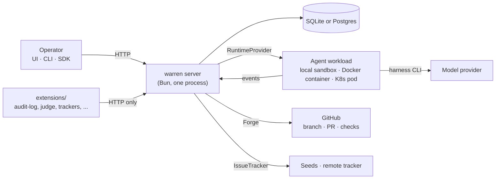
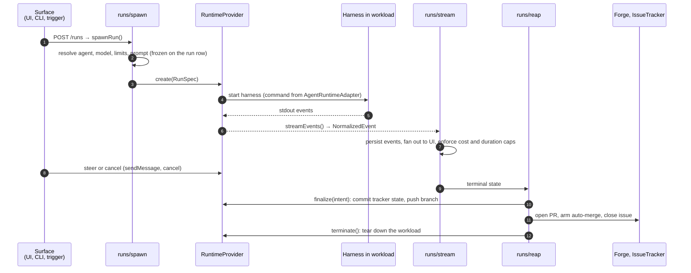
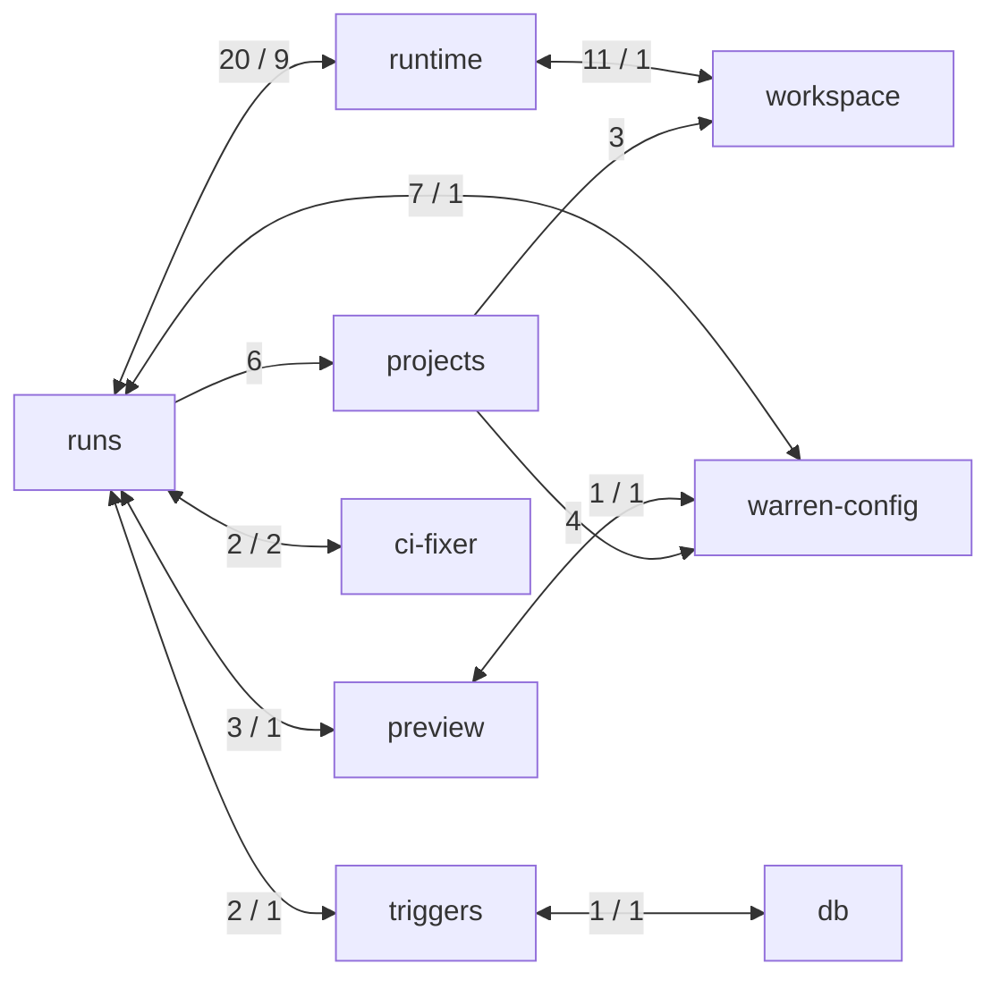
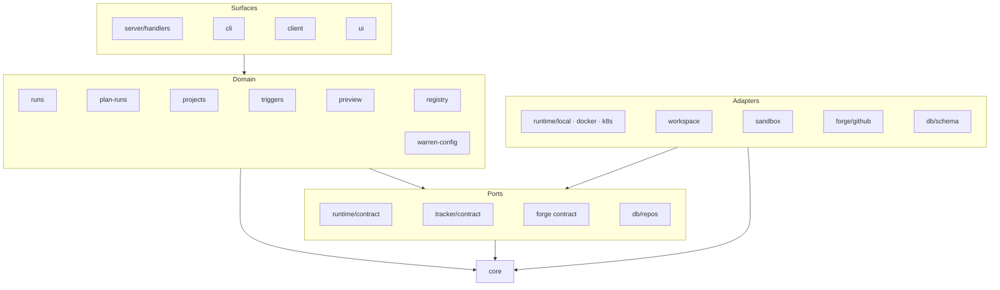

# Architecture: the code map

This page tells you where things are in the code, and which module may depend on which.
For the concepts (run kernel, harness adapters, runtime providers, seams), read
[docs/architecture.md](docs/architecture.md) first. For decisions, read
[docs/design/](docs/design/README.md).

The page has two halves. The first half describes the code as it is. The second half
describes the target structure and the open issues that move the code there. Tracking
issue: [namphuongtran/warren#107](https://github.com/namphuongtran/warren/issues/107).

## Bird's-eye view

Warren is a control plane. It takes a task, runs a coding-agent harness in an isolated
workload, watches it, and delivers the result as a pushed branch (plus an optional pull
request).

The work is I/O-bound. A run waits minutes on a model and seconds on a container or a
`git push`. The process itself does little CPU work.



## Layers

Every top-level module under `src/` belongs to one layer. A module imports from its own
layer or from layers below it, never above. `scripts/layer-rules.json` enforces some of
these directions today. The rest are the target (see "Gaps").

| Layer | Purpose | Modules |
|---|---|---|
| Kernel | Wire vocabulary shared by server, SDK, and UI. Imports nothing. | `src/core/` |
| Domain | Run lifecycle and the features around it. | `src/runs/`, `src/plan-runs/`, `src/projects/`, `src/registry/`, `src/triggers/`, `src/ci-fixer/`, `src/healer/`, `src/preview/`, `src/warren-config/` |
| Ports | The contracts that the domain calls. | `src/runtime/contract.ts`, `src/runtime/adapters/` (the `AgentRuntimeAdapter` contract and registry), `src/tracker/contract.ts`, the `Forge` contract in `src/forge/`, the repos in `src/db/repos/` |
| Adapters | Implementations of the ports, plus infrastructure helpers. | `src/runtime/local/`, `src/runtime/docker/`, `src/runtime/k8s/`, `src/runtime/fake/`, `src/sandbox/`, `src/workspace/`, `src/forge/github*/`, `src/tracker/` implementations, `src/seeds-cli/`, `src/db/schema/`, `src/db/client.ts`, `src/observability/` |
| Surfaces | Thin consumers of the domain. | `src/server/handlers/`, `src/cli/`, `src/client/` (SDK), `src/ui/` (browser bundle) |
| Composition | Reads env and config once, wires everything, starts the server. | `src/server/main/`, `src/supervisor/`, `src/server-config/`, `src/instance/`, `src/diagnostics/` |
| Out of process | Separate packages that use only the published HTTP API. | `extensions/` |

## One run, end to end



| Step | Owner | Entry point |
|---|---|---|
| Dispatch | `src/runs/spawn/` | `spawnRun` in `src/runs/spawn/dispatch.ts` |
| Placement | `src/runtime/<provider>/` | `RuntimeProvider.create` in `src/runtime/contract.ts` |
| Harness semantics | `src/runtime/adapters/` | one adapter per harness: Claude Code, Codex, Pi |
| Event bridge | `src/runs/stream/` | `src/runs/stream/bridge.ts` |
| Live limits | `src/runs/` (`watchdog*.ts`, `cost-cap.ts`, `duration-limit.ts`) | `src/runs/watchdog.ts` |
| Reap | `src/runs/reap/` | `src/runs/reap/run.ts`, `src/runs/reap/pipeline.ts` |
| Delivery | `src/runs/pr*.ts`, `src/runs/reap/pr-open.ts`, `src/runs/reap/auto-merge-*.ts` | `src/runs/reap/pr-open.ts` |
| Recovery | `src/runs/retry/`, `src/runs/quota/` | `src/runs/retry/provider-retry.ts` |
| Multi-issue plans | `src/plan-runs/` | walks children one at a time over `spawnRun` |

## Seams

Boot resolves each seam once. Call sites receive the instance and branch on its
capability flags, never on a provider name (`scripts/check-runtime-ids.ts` guards the
runtime ids).

| Seam | Contract | Implementations | Resolved by |
|---|---|---|---|
| `RuntimeProvider` | `src/runtime/contract.ts` | `local`, `docker`, `k8s`, `fake` (tests) | `WARREN_RUNTIME`, in `src/runtime/registry.ts` |
| `AgentRuntimeAdapter` | `src/runtime/adapters/` | Claude Code, Codex, Pi | the agent's runtime id |
| `IssueTracker` | `src/tracker/contract.ts` | Seeds (in process), `RemoteTracker` (`warren-tracker/v1` over HTTP) | project files and config |
| `Forge` | `src/forge/` | GitHub PAT, GitHub App | server config |
| Persistence | `src/db/repos/` | SQLite (default), Postgres (`WARREN_DB_URL`) | `src/db/client.ts` |

## Rules that the gates enforce

| Rule | Guard |
|---|---|
| Wire enums live once, in `src/core/wire.ts`. | `scripts/check-wire-types.ts` |
| Domain modules do not import `src/server/` or `src/cli/`. | `domain-owns-the-logic` in `scripts/layer-rules.json` |
| Handlers do not build queries or repos. | `handlers-are-a-thin-surface`, `handlers-do-not-build-repos` |
| Only `src/forge/` speaks the GitHub API. | `github-api-literal-is-forge-only`, `forge-transport-is-forge-only` |
| `src/ui/` imports only `src/core/` and the SDK's ndjson reader. | `ui-is-a-browser-consumer` |
| `src/core/` imports nothing. | `core-kernel-imports-nothing` |
| Extensions and core never import each other. | `extensions-are-standalone`, `core-does-not-import-extensions` |
| Runtime ids appear only under `src/runtime/adapters/`. | `scripts/check-runtime-ids.ts` |

## The module graph today

Measured at `c771796e` over non-test files, counting runtime imports only. The compiler
erases `import type`, so those imports do not count. Nine modules form one strongly connected
component: each can reach every other one through imports.



Labels give the import count in each direction. Each cycle comes from a few helpers in
the wrong module:

| Edge that closes a cycle | What it imports | Fix |
|---|---|---|
| `runtime -> runs` | `defaultExec`, `defaultFs`, git helpers, `.mulch/` and `.seeds/` staging, from `src/runs/reap/` | [#93](https://github.com/namphuongtran/warren/issues/93) |
| `workspace -> runtime` | `commitExcludes` from `src/runtime/adapters/` | [#94](https://github.com/namphuongtran/warren/issues/94) |
| `warren-config -> runs` | `parsePrTemplate` from `src/runs/pr-template.ts` | [#94](https://github.com/namphuongtran/warren/issues/94) |
| `warren-config -> preview`, `runs -> preview` | `parseDurationMs` | [#94](https://github.com/namphuongtran/warren/issues/94) |
| `preview -> runs` | `LOCAL_WORKER_NAME` | [#94](https://github.com/namphuongtran/warren/issues/94) |
| `runs -> ci-fixer` | `CI_FIXER_TRIGGER` | [#94](https://github.com/namphuongtran/warren/issues/94) |
| `db -> triggers` | `AUTOMATIC_RUN_TRIGGERS` | [#94](https://github.com/namphuongtran/warren/issues/94) |
| `runs <-> triggers` | automatic-run admission and branch-prefix helpers | [#94](https://github.com/namphuongtran/warren/issues/94) |

### `src/runs/` today

`src/runs/` holds 27k lines in 144 files. Its top level has 38 non-test files. Name
prefixes stand in for missing directories. PR delivery lives partly at the top level and
partly in `reap/`.

```text
src/runs/
├── index.ts                     public barrel
├── spawn/  stream/  reap/  retry/  quota/  quality-gate/  analytics/
├── pr.ts  pr-template.ts  pr-annotate.ts  pr-agent-report.ts
│   pr-checks.ts  pr-handoff.ts  pr-merge.ts                 delivery
├── watchdog.ts  watchdog-config.ts  watchdog-reconcile.ts
│   watchdog-tool-stall.ts  tool-stall-view.ts
│   cost-cap.ts  duration-limit.ts                           supervision
├── cost-analytics.ts  usage-aggregate.ts  usage-hydrate.ts
│   tool-calls-backfill.ts  ops-stats.ts  ops-overview.ts
│   events-query.ts                                          read side
└── cancel.ts  steer.ts  inbox.ts  events.ts  lifecycle-bus.ts
    seed.ts  branch.ts  target-branch.ts  ...                lifecycle
```

## Target structure

The design does not change: same seams, same kernel, same layers. The target makes the
code obey the layers, with no cycles, and gives `src/runs/` one directory per subdomain.



Arrows point down only. Adapters implement ports and never import the domain. The
composition root (`src/server/main/`) is the one place that knows every layer.

### `src/runs/` target

```text
src/runs/
├── index.ts         public barrel, unchanged names
├── lifecycle/       identity, branch naming, cancel, steer, inbox, events, lifecycle bus
├── spawn/           dispatch: resolve agent, model, limits, prompt; call create()
├── stream/          event bridge: persist, fan out, live budget checks
├── supervision/     watchdog, tool-stall detection, cost cap, wall-clock limit
├── reap/            terminal pipeline: finalize, push, teardown
├── delivery/        PR open, template, annotate, checks, merge, auto-merge
├── retry/           provider-error, infra-loss, and quota resume
├── quota/           subscription quota holds
├── quality-gate/    gate command and outcome
└── insights/        read side: analytics, usage, cost, ops stats
```

Allowed directions inside `src/runs/`:

- `spawn`, `stream`, `supervision`, `reap`, `delivery`, `retry` may import `lifecycle`.
- `reap` calls `delivery`. `delivery` does not import `reap`.
- `supervision` may call cancel and reap entry points. `spawn` and `reap` do not import
  `supervision`.
- `insights` reads only. It imports none of the write-side subdomains.

## Gaps and the issues that close them

| Gap | Issue |
|---|---|
| No gate sees import cycles. | [#92](https://github.com/namphuongtran/warren/issues/92) adds a cycle gate with a shrinking allowlist |
| Runtime adapters import the domain. | [#93](https://github.com/namphuongtran/warren/issues/93) |
| The other cycles. | [#94](https://github.com/namphuongtran/warren/issues/94) |
| Four domain files build `drizzle-orm` queries. | [#95](https://github.com/namphuongtran/warren/issues/95) |
| `src/runs/` is flat. | [#96](https://github.com/namphuongtran/warren/issues/96) delivery, [#97](https://github.com/namphuongtran/warren/issues/97) supervision, [#98](https://github.com/namphuongtran/warren/issues/98) insights, [#99](https://github.com/namphuongtran/warren/issues/99) lifecycle |
| 19 files sit at the 500-line ceiling. | [#100](https://github.com/namphuongtran/warren/issues/100) |
| Comments carry tracker ids instead of intent. | [#101](https://github.com/namphuongtran/warren/issues/101) rule and ratchet, [#103](https://github.com/namphuongtran/warren/issues/103) contract files |
| Code still names the retired burrow daemon. | [#102](https://github.com/namphuongtran/warren/issues/102) |
| `RunSpec` carries provider-specific fields, and ignored knobs drop silently. | [#104](https://github.com/namphuongtran/warren/issues/104) |
| The fork has not decided which subsystems it keeps. | [#105](https://github.com/namphuongtran/warren/issues/105) |
| `AGENTS.md` mixes the agent contract with reference material. | [#106](https://github.com/namphuongtran/warren/issues/106) |

When an issue lands, update this page: move the change from "today" to "target", and
remove the row above.

## Where to start reading

1. `src/core/wire.ts`: the states and enums every surface shares.
2. `src/runtime/contract.ts`: what a runtime provider must do.
3. `src/runs/spawn/dispatch.ts`: how a run starts.
4. `src/runs/stream/bridge.ts`: how events flow in.
5. `src/runs/reap/run.ts`: how a run ends and delivers.
6. `src/server/main/index.ts`: how boot wires it all.
