# Architecture overview (C4 + flows)

**Kind:** historical-evidence
**Design state:** approved
**Delivery:** not-applicable
**Arrived:** 2026-11-20

> A snapshot of the architecture at commit `5e547640` (main). If the code and
> this document disagree, the code wins. The other design records in this
> directory give the details for each seam. This document is only the overview map.

The document follows the C4 model, from the outside in:

1. **Context**: where Warren sits between users and external systems.
2. **Container**: the processes and data stores that actually run.
3. **Component**: the modules inside the Warren server.
4. **Flows**: how a run moves through the system (dispatch → stream → reap).

Color convention in all diagrams: 🟦 dark blue is Warren, 🟩 green is the user,
⬜ gray is an external system, 🟧 orange is where the agent actually runs (sandbox).

---

## 1. C4 Level 1 — System Context

Warren turns coding agents (Claude Code, Pi) into infrastructure. It takes a task, runs
the agent in an isolated sandbox, and then delivers the result as a **pushed git branch**
(and, depending on configuration, a PR, auto-merge, and issue close).

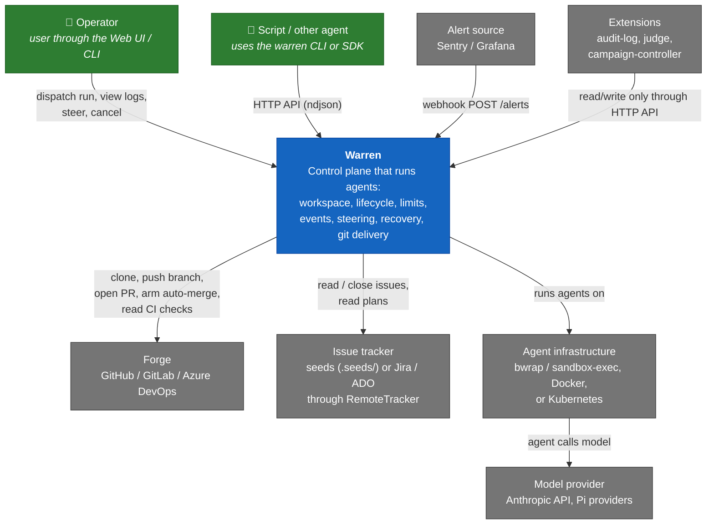

Key points:

- Warren does **not** call the model. The agent harness inside the sandbox calls the model.
  Warren only reads the event stream that the harness prints.
- The kernel guarantees one thing only: a **pushed branch**. PR, auto-merge, and issue close are
  optional steps, set by the project's `.warren/config.yaml`.
- Extensions are separate processes. They talk only through the public HTTP API and do not
  import `src/`.

---

## 2. C4 Level 2 — Containers

### 2.1 Default topology (`WARREN_RUNTIME=local`)

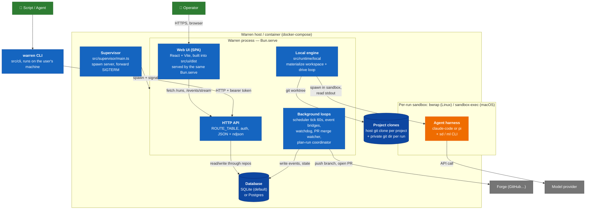

### 2.2 Three runtime providers: they differ only in where the agent runs

Domain code (`src/runs/*`) talks only to the `RuntimeProvider` interface.
Warren selects the provider **once at boot** from the `WARREN_RUNTIME` variable
(`src/runtime/registry.ts`).

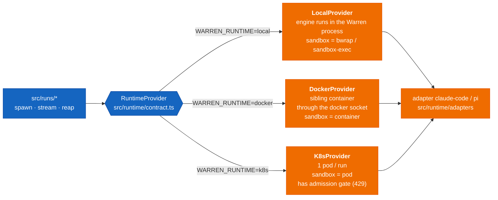

| | Local | Docker | K8s |
|---|---|---|---|
| Agent runs in | child process in bwrap / sandbox-exec | sibling container | its own pod |
| Events reach Warren by | reading the child process stdout | container stdout through the docker CLI | following the pod log |
| Warren restart | live runs are marked `lost` | see [Docker runtime provider](./runtime-docker-provider.md) | the pod keeps running, pod-watcher re-attaches at boot |
| Finalize (commit + push) | the engine does it on the host | see [Docker runtime provider](./runtime-docker-provider.md) | the pod calls `GET /runs/:id/finalize-intent`, then `POST /runs/:id/finalize-result` |

---

## 3. C4 Level 3 — Components inside the Warren server

The arrows below follow the real dependency direction in the code. The layer rules
(`scripts/layer-rules.json`) forbid the reverse direction.

```mermaid
flowchart TB
    subgraph surface["Surface — thin, no logic"]
        handlers["<b>HTTP handlers</b><br/>src/server/handlers<br/>route-table.ts · auth.ts · router.ts"]
        clic["<b>CLI commands</b><br/>src/cli/commands"]
        ui["<b>UI</b><br/>src/ui"]
        sdk["<b>SDK client</b><br/>src/client"]
    end

    subgraph boot["Composition root"]
        main["<b>bootServer</b><br/>src/server/main/index.ts<br/>wire deps · bridges · scheduler ·<br/>watchdog · lifecycle bus"]
    end

    subgraph domain["Domain — the real logic, one place per task"]
        spawn["<b>runs/spawn</b><br/>spawnRun()"]
        stream["<b>runs/stream</b><br/>bridgeRunStream()<br/>write events + broker"]
        reap["<b>runs/reap</b><br/>reapRun() + pipeline"]
        planruns["<b>plan-runs</b><br/>coordinator · advancePlanRun()"]
        triggers["<b>triggers</b><br/>scheduler tick · cron ·<br/>scheduled seeds"]
        healer["<b>healer</b> · <b>ci-fixer</b>"]
        projects["<b>projects</b><br/>addProject · clone · refresh"]
        registry["<b>registry</b><br/>7 builtin agents"]
        wcfg["<b>warren-config</b><br/>.warren/config.yaml"]
        bus["<b>lifecycle bus</b><br/>observe-only"]
        preview["<b>preview</b><br/>preview environments"]
    end

    subgraph seams["Provider seams — selected at boot"]
        runtime["<b>runtime</b><br/>RuntimeProvider<br/>local · docker · k8s · adapters"]
        sandbox["<b>sandbox</b><br/>bwrap · seatbelt · git-scope"]
        workspace["<b>workspace</b><br/>materialize checkout"]
        forge["<b>forge</b><br/>Forge: github · github-app ·<br/>gitlab · ado"]
        tracker["<b>tracker</b><br/>IssueTracker: seeds · remote"]
    end

    subgraph data["Data"]
        repos["<b>db/repos</b><br/>runs · events · projects ·<br/>agents · plan-runs · triggers"]
        schema[("drizzle schema<br/>sqlite · postgres")]
    end

    core["<b>core</b><br/>src/core/wire.ts<br/>wire vocabulary, imports nothing"]

    ui -- "HTTP" --> handlers
    sdk -- "HTTP" --> handlers
    clic --> sdk
    main --> handlers
    main --> triggers
    main --> stream

    handlers --> spawn
    handlers --> planruns
    handlers --> projects
    triggers --> spawn
    planruns --> spawn
    healer --> spawn

    spawn --> registry
    spawn --> wcfg
    spawn --> projects
    spawn --> runtime
    spawn --> bus
    stream --> runtime
    stream --> reap
    reap --> runtime
    reap --> forge
    reap --> tracker
    reap --> preview
    planruns --> forge
    planruns --> tracker

    runtime --> sandbox
    runtime --> workspace

    spawn --> repos
    stream --> repos
    reap --> repos
    repos --> schema

    ui -.-> core
    sdk -.-> core
    repos -.-> core

    classDef surf fill:#5c6bc0,stroke:#283593,color:#fff
    classDef dom fill:#1565c0,stroke:#0d47a1,color:#fff
    classDef seam fill:#ef6c00,stroke:#e65100,color:#fff
    classDef dat fill:#0d47a1,stroke:#002171,color:#fff
    class handlers,clic,ui,sdk,main surf
    class spawn,stream,reap,planruns,triggers,healer,projects,registry,wcfg,bus,preview dom
    class runtime,sandbox,workspace,forge,tracker seam
    class repos,schema,core dat
```

Three main design principles:

- **Single source of truth.** Each capability has exactly one implementation. For example,
  `spawnRun` lives only in `src/runs/spawn/dispatch.ts`. The HTTP handler, scheduler,
  plan-run, healer, and ci-fixer all call this same function.
- **Seams selected at boot.** Warren resolves `RuntimeProvider`, `Forge`, and `IssueTracker`
  once and injects them into `deps`. Calling code branches only on capability
  flags, not on the provider name.
- **`src/core/` imports nothing.** Because of this, the UI (a browser bundle) can share
  the wire data types with the server without pulling in drizzle or `bun:sqlite`.

### 3.1 The `RuntimeProvider` interface (8 methods)

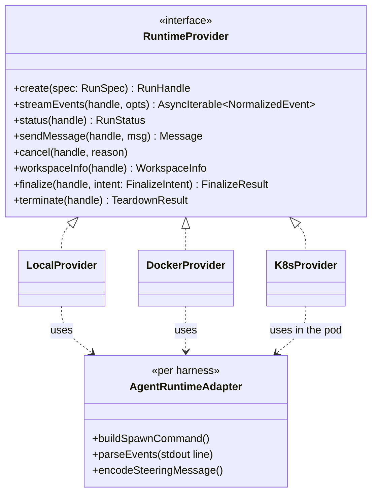

`RuntimeProvider` answers the question *where does the agent run*. `AgentRuntimeAdapter` answers
the question *which harness runs and how to read its output*. The two axes are independent, so
a new harness needs no change to the providers.

---

## 4. Flow — the lifecycle of a run

### 4.1 Who can create a run

Every path leads to one function: `spawnRun`.

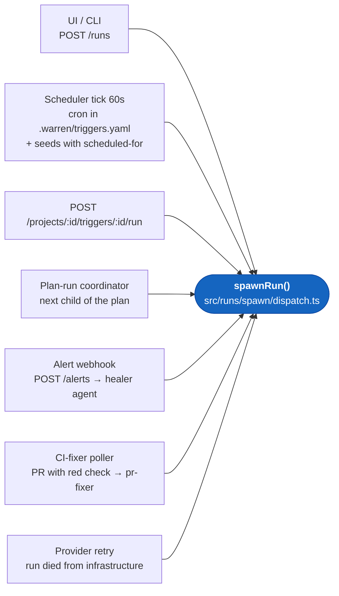

### 4.2 Sequence: dispatch → run → reap

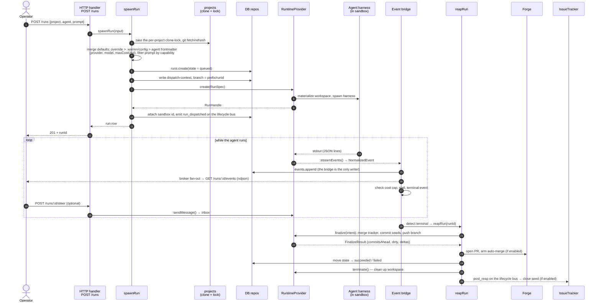

### 4.3 Run state machine

The state vocabulary lives in `src/core/wire.ts` (`RUN_STATES`).

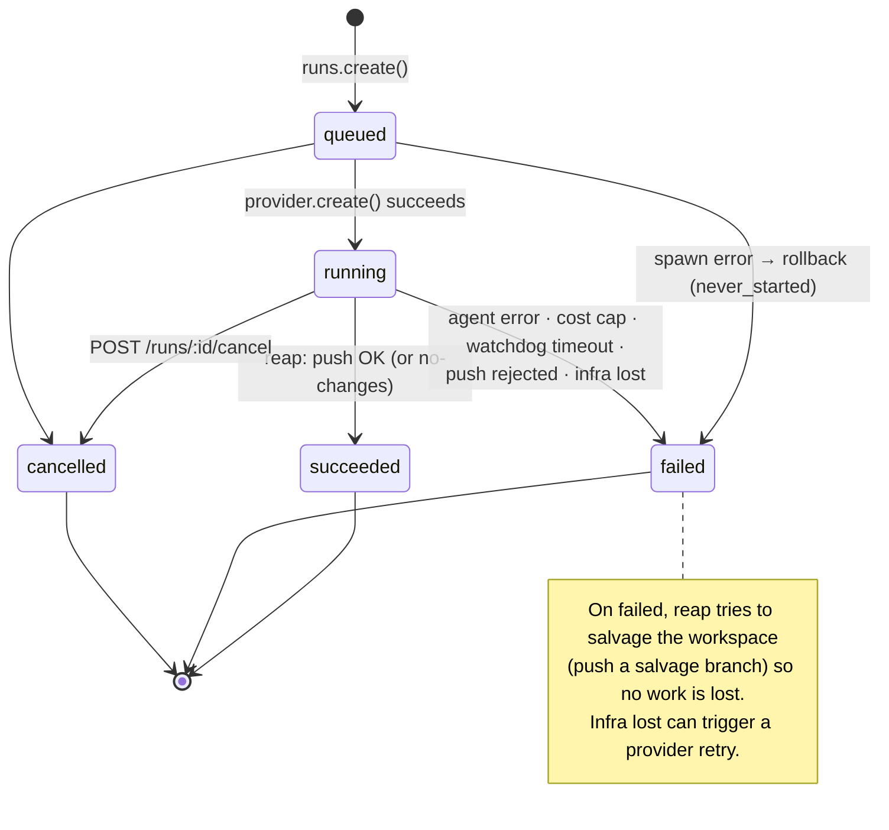

### 4.4 Reap pipeline in detail

Reap is the "harvest" step after the agent stops. It puts the result on git, decides
the final state, and then cleans up the sandbox. The code lives in `src/runs/reap/`:
`run.ts` (`reapRun`, coordination), `pipeline.ts` (the chain of steps when a workspace exists),
`finalize-intent.ts`, `pr-open.ts`, `salvage.ts`, `destroy.ts`.

**Who calls reap.** The event bridge when it detects a terminal event, bridge-reconnect,
the watchdog (run silent past the heartbeat, default 45 minutes), cancel
(`POST /runs/:id/cancel`, plan-run cancel), and pause/resume. Every caller
passes an initial `outcome` (`succeeded` / `failed` / `cancelled`).

```mermaid
flowchart TB
    trig(["reapRun(runId, outcome)<br/>from bridge · watchdog · cancel"]) --> g0{"run already<br/>terminal?"}
    g0 -- "yes" --> idem["reap.skipped<br/>(idempotent)"]
    g0 -- "no" --> p1

    subgraph phase1["① Classify the input — run.ts"]
        direction TB
        p1["markAgentEnded"] --> p2["scan the event log for a<br/>provider error in the last turn<br/>→ force outcome = failed"]
        p2 --> p3["provider.workspaceInfo()<br/>→ workspacePath, branch"]
        p3 --> p4["baseBranch = run.ref<br/>?? project.defaultBranch"]
        p4 --> p5["bus: pre_reap"]
    end

    p5 --> route{"choose branch"}
    route -- "state still queued" --> s1["reap.never_started_skip"]
    route -- "spawn exec error" --> s2["reap.spawn_failed_skip"]
    route -- "project deleted" --> s3["reap.orphaned"]
    route -- "normal" --> b0

    subgraph phase2["② Pipeline — pipeline.ts"]
        direction TB
        b0["snapshot plans.jsonl<br/>of the clone (baseline)"] --> b1

        subgraph fin["provider.finalize(intent) — 1 call"]
            direction TB
            b1["merge mulch → clone"] --> b2["merge seeds → clone"]
            b2 --> b3["mirror plans → clone"]
            b3 --> b4["capture plans.jsonl<br/>of the workspace"]
            b4 --> b5["commit chore(warren)<br/>seeds state"]
            b5 --> b6["reset files that warren seeded<br/>(keep them out of the PR)"]
            b6 --> b7["git push branch<br/>(credential minted on the spot)"]
            b7 --> b8["count commitsAhead,<br/>dirty paths"]
        end

        b8 --> c1{"push OK and<br/>commitsAhead = 0?"}
        c1 -- "yes" --> c2["classifyEmptyPush<br/>→ noChanges or droppedCommit"]
        c1 -- "no" --> c3
        c2 --> c3["K8s: apply mirror delta<br/>to the host clone"]
        c3 --> c4["write outcome facts<br/>commitsAhead + diff stats"]
        c4 --> c5["auto-plan-run:<br/>new plan → create plan-run"]
        c5 --> c6["open PR + arm auto-merge"]
        c6 --> c7["preview launch<br/>+ write URL into the PR"]
    end

    c7 --> d0
    s1 --> d0
    s2 --> d0
    s3 --> d0

    subgraph phase3["③ Settle the result — run.ts"]
        direction TB
        d0["compute effectiveOutcome<br/>+ failureReason"] --> d1{"finalize<br/>failed?"}
        d1 -- "yes" --> d2["salvage: push rescue ref<br/>or git bundle"]
        d1 -- "no" --> d3
        d2 --> d3["transitionToTerminal<br/>+ emit reap.completed"]
        d3 --> d4["provider.terminate()<br/>unless the workspace must be kept"]
        d4 --> d5["bus: branch_pushed, post_reap<br/>→ seed-close closes the seed"]
        d5 --> d6["infra lost?<br/>→ automatic retry, once"]
    end

    classDef seam fill:#ef6c00,stroke:#e65100,color:#fff
    classDef dom fill:#1565c0,stroke:#0d47a1,color:#fff
    class b1,b2,b3,b4,b5,b6,b7,b8 seam
    class c1,c2,c3,c4,c5,c6,c7 dom
```

Orange marks the part that touches the workspace. This part is grouped into **one**
`provider.finalize()` call. Local runs it on the host. K8s runs it in the pod and then POSTs the result
back. Blue marks the domain steps, which run in Warren for every provider.

#### Empty push classification (`classifyEmptyPush`)

| Workspace after push | Conclusion | State |
|---|---|---|
| clean, 0 new commits | `noChanges`: the agent changed nothing | `succeeded`, except a run that targets `ref` / `targetBranch` gets `failed` / `no_changes` |
| only bookkeeping files dirty | `noChanges` | same as above |
| real files dirty, 0 commits | `droppedCommit`: the agent made changes but forgot to commit | `failed` / `dropped_commit` |

#### `failureReason` priority order

A run with `outcome = succeeded` can still flip to `failed`. The first
reason in the list that matches wins:

1. `dropped_commit`
2. `no_changes` (only for a run that targets an existing ref)
3. infra loss: Spot preemption, pod disappeared, OOM
4. `provider_error`: for example, API credit ran out
5. `finalize_unposted` → `push_rejected_policy` → `finalize_failed`
6. a reason that the caller passes in, or that comes from the event log

#### When the workspace is **not** deleted

- The push fails **and** the salvage also fails: Warren keeps the workspace so the operator can
  recover the work by hand.
- A preview is still `live` / `starting`: the eviction worker does the deletion instead.

#### Design principles

- **Best-effort for each step.** A step that fails emits `reap_failed {step}` and the pipeline
  continues. The pipeline does not throw.
- **Fail closed when delivery is not certain.** If finalize throws or Warren cannot read
  the workspace, Warren treats it as a failed push. The run cannot show
  `succeeded`, and Warren salvages or keeps the workspace.
- **Credentials are minted just before use**, and are not stored in config.
- **Auto-merge never fails a run.** The arm step emits exactly one event and
  stays fully silent when the project does not enable `pr.autoMerge`.
- **Secondary features hang off the lifecycle bus.** Seed close is a subscriber of
  `post_reap`, not a step in the pipeline. To remove the feature, remove the subscription.

### 4.5 A run in K8s: the pod calls back to Warren

The K8s topology has no host-side engine. The pod runs the harness itself through
`agent-entrypoint.ts` and uses HTTP to get what it needs.

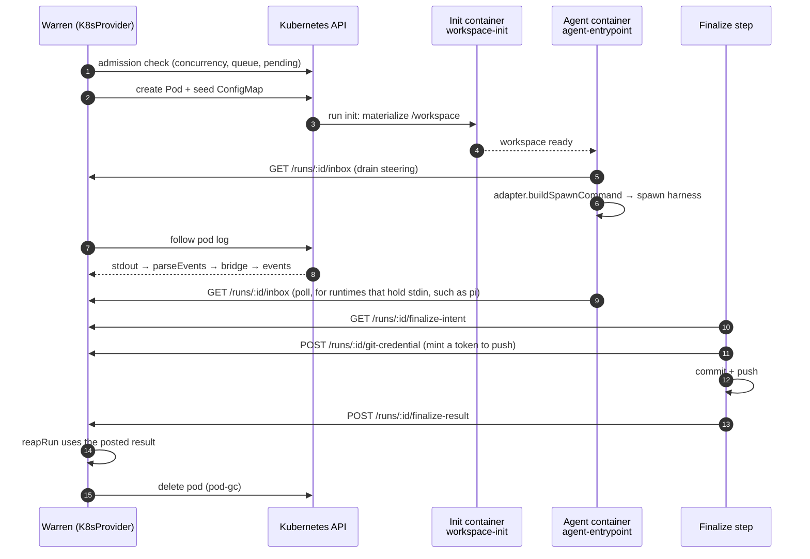

### 4.6 Plan-run: a chain of issues gated on PR merge

`POST /plan-runs` with `planId` (a tracker that supports plans, for example seeds) or a list
of issue ids. The coordinator runs one child at a time. The next child starts only when the PR of
the previous child has merged.

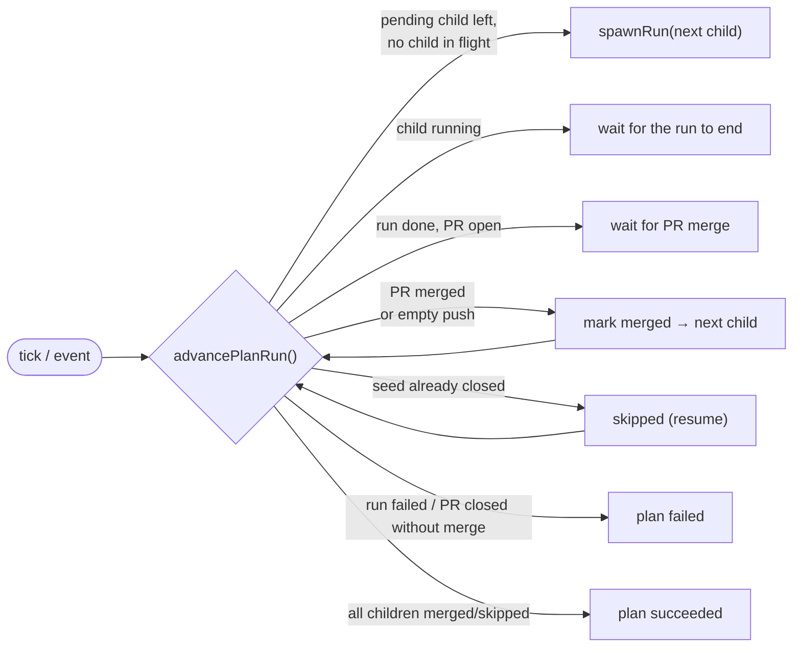

A new dispatch of the same plan **resumes** from the next open child, because Warren skips a child
whose seed is already closed.

---

## 5. Boot sequence

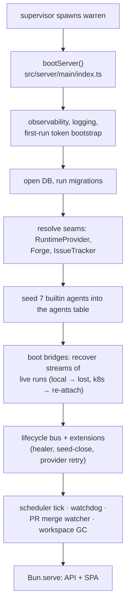

---

## 6. Directory map

| Directory | Role |
|---|---|
| `src/supervisor/` | Parent process. Spawns the server, forwards signals. |
| `src/server/main/` | Composition root. All boot-time wiring. |
| `src/server/handlers/` | Thin HTTP handlers. `route-table.ts` is the official route list. |
| `src/runs/spawn/` | `spawnRun`: the one place that creates runs. |
| `src/runs/stream/` | Event bridge. The only writer of the `events` table, fan-out to tailers. |
| `src/runs/reap/` | Run end: finalize, push, PR, auto-merge, salvage, teardown. |
| `src/plan-runs/` | Coordinator that runs a chain of issues in order, gated on PR merge. |
| `src/triggers/` | Scheduler tick: cron, scheduled seeds, ci-fixer pass, project heal. |
| `src/healer/`, `src/ci-fixer/` | Self-repair loops: alert → healer, red CI → pr-fixer. |
| `src/runtime/` | `RuntimeProvider` contract + local / docker / k8s + harness adapters. |
| `src/sandbox/` | bwrap (Linux), seatbelt (macOS), git scope, proxy. |
| `src/workspace/` | Materializes the checkout for each run. |
| `src/forge/` | `Forge` contract: GitHub, GitHub App, GitLab, ADO. The only place that calls the GitHub API. |
| `src/tracker/` | `IssueTracker` contract: seeds + RemoteTracker. |
| `src/projects/` | Project registration, clone, refresh, per-project lock. |
| `src/registry/` | Definitions of the 7 builtin agents. Protected path (Article IX). |
| `src/warren-config/` | Reads `.warren/config.yaml` for each project. |
| `src/db/` | Drizzle schema (sqlite + postgres) and repos. |
| `src/core/` | Wire vocabulary shared by server / SDK / UI. Imports nothing. |
| `src/client/` | TypeScript SDK for the HTTP API. |
| `src/cli/` | `warren` CLI (commander), uses the SDK. |
| `src/ui/` | React SPA, separate package `@os-eco/warren-ui`. |
| `src/preview/` | Per-run preview environments (proxy, port, eviction). |
| `src/observability/` | Log redaction, Prometheus metrics, error tracking. |
| `extensions/` | Standalone packages, use only the public HTTP API. |

## Further reading

- [RuntimeProvider contract](./runtime-provider-contract.md)
- [Runtime and supervisor](./runtime-and-supervisor.md)
- [Agent composition](./agent-composition.md)
- [PlanRun coordinator](./plan-run-coordinator.md)
- [Forge contract](./forge-contract.md) · [IssueTracker contract](./issue-tracker.md)
- [Kubernetes migration](./k8s-migration.md) · [Docker runtime provider](./runtime-docker-provider.md)
- [Tier-1 observation bus](./tier1-observation-bus.md) · [Scheduler](./scheduler.md)
