# Architecture overview (C4 + flows)

**Kind:** historical-evidence
**Design state:** approved
**Delivery:** not-applicable
**Arrived:** 2026-11-20

> Ảnh chụp kiến trúc tại commit `5e547640` (main). Nếu code và tài liệu này
> lệch nhau thì code thắng. Các design record khác trong thư mục này là nguồn
> chi tiết cho từng seam; tài liệu này chỉ là bản đồ tổng quan.

Tài liệu đi theo mô hình C4, từ ngoài vào trong:

1. **Context**: Warren nằm ở đâu giữa người dùng và hệ thống bên ngoài.
2. **Container**: các process và kho dữ liệu chạy thật.
3. **Component**: các module bên trong server Warren.
4. **Flows**: một run đi qua hệ thống như thế nào (dispatch → stream → reap).

Quy ước màu trong mọi sơ đồ: 🟦 xanh đậm là Warren, 🟩 xanh lá là người dùng,
⬜ xám là hệ thống bên ngoài, 🟧 cam là nơi agent thực sự chạy (sandbox).

---

## 1. C4 Level 1 — System Context

Warren biến coding agent (Claude Code, Pi) thành hạ tầng: nhận một task, chạy
agent trong sandbox cô lập, rồi giao kết quả dưới dạng một **git branch đã push**
(và tùy cấu hình: PR, auto-merge, đóng issue).

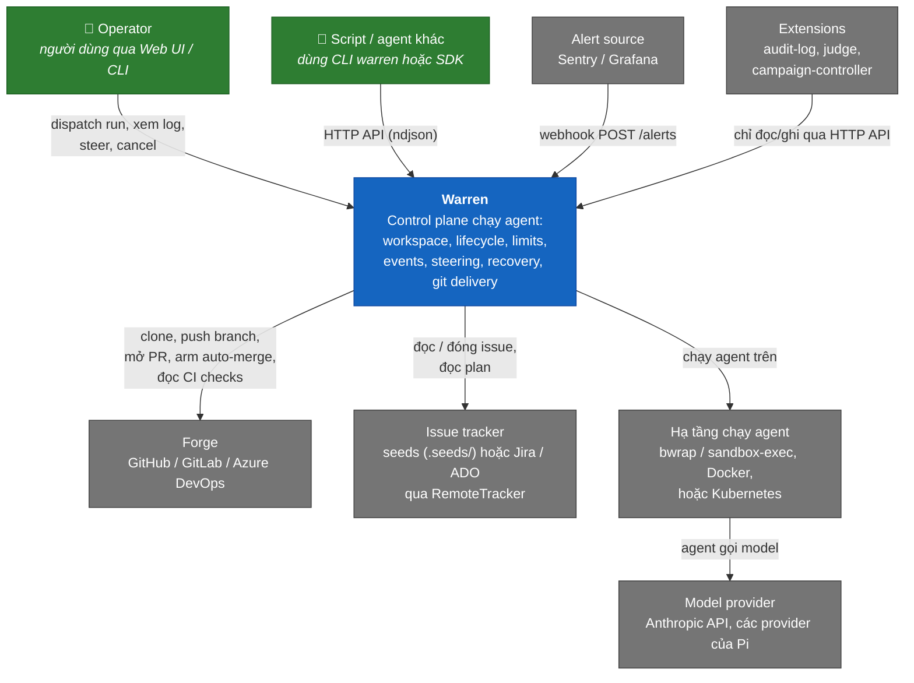

Điểm cần nhớ:

- Warren **không** gọi model. Agent harness bên trong sandbox gọi model; Warren
  chỉ đọc event stream mà harness in ra.
- Kernel chỉ cam kết một thứ: **branch đã push**. PR, auto-merge, đóng issue là
  bước tùy chọn theo `.warren/config.yaml` của project.
- Extensions là process riêng, chỉ nói chuyện qua HTTP API công khai, không
  import `src/`.

---

## 2. C4 Level 2 — Containers

### 2.1 Topology mặc định (`WARREN_RUNTIME=local`)

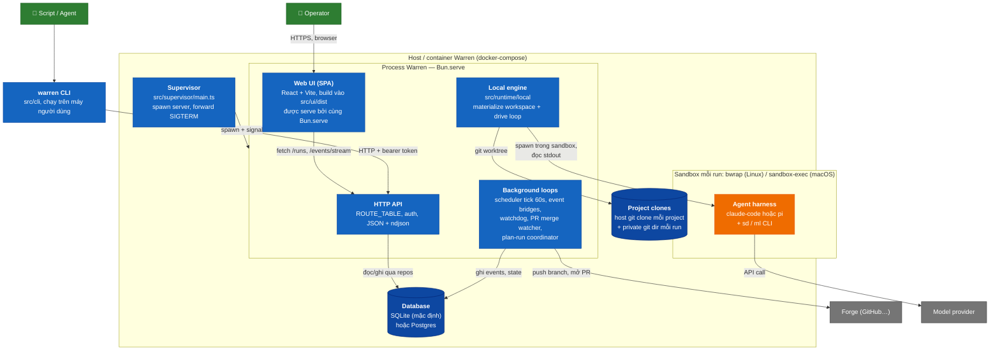

### 2.2 Ba runtime provider — chỉ khác ở chỗ agent chạy

Domain code (`src/runs/*`) chỉ nói chuyện với interface `RuntimeProvider`.
Provider được chọn **một lần lúc boot** từ biến `WARREN_RUNTIME`
(`src/runtime/registry.ts`).

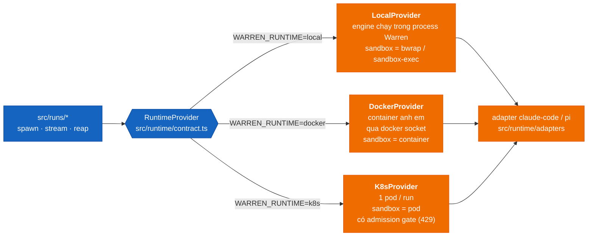

| | Local | Docker | K8s |
|---|---|---|---|
| Agent chạy ở | process con trong bwrap / sandbox-exec | container anh em | pod riêng |
| Event về Warren | đọc stdout của process con | stdout của container qua docker CLI | follow log của pod |
| Warren restart | run đang chạy bị đánh dấu `lost` | xem [Docker runtime provider](./runtime-docker-provider.md) | pod sống tiếp, pod-watcher gắn lại lúc boot |
| Finalize (commit + push) | engine làm trên host | xem [Docker runtime provider](./runtime-docker-provider.md) | pod gọi `GET /runs/:id/finalize-intent`, rồi `POST /runs/:id/finalize-result` |

---

## 3. C4 Level 3 — Components bên trong Warren server

Các mũi tên dưới đây đi theo chiều phụ thuộc thật trong code. Quy tắc tầng
(`scripts/layer-rules.json`) cấm chiều ngược lại.

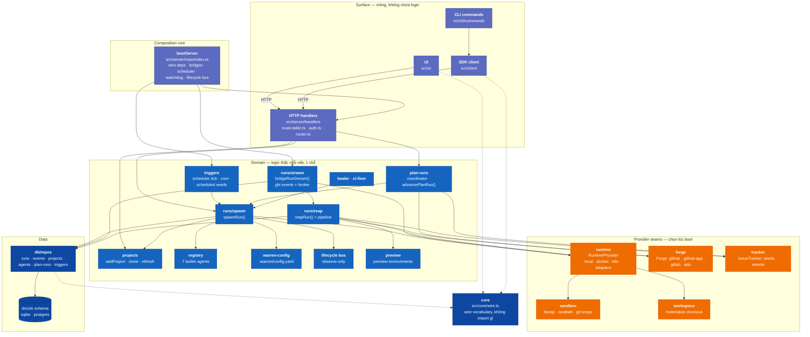

Ba nguyên tắc thiết kế nổi bật:

- **Single source of truth.** Mỗi năng lực có đúng một hiện thực. Ví dụ
  `spawnRun` chỉ nằm ở `src/runs/spawn/dispatch.ts`; HTTP handler, scheduler,
  plan-run, healer, ci-fixer đều gọi chung hàm này.
- **Seam chọn lúc boot.** `RuntimeProvider`, `Forge`, `IssueTracker` đều được
  resolve một lần rồi tiêm vào `deps`. Code gọi chỉ rẽ nhánh theo capability
  flag, không theo tên provider.
- **`src/core/` không import gì.** Nhờ vậy UI (bundle trình duyệt) dùng chung
  được kiểu dữ liệu wire với server mà không kéo theo drizzle hay `bun:sqlite`.

### 3.1 Interface `RuntimeProvider` (8 method)

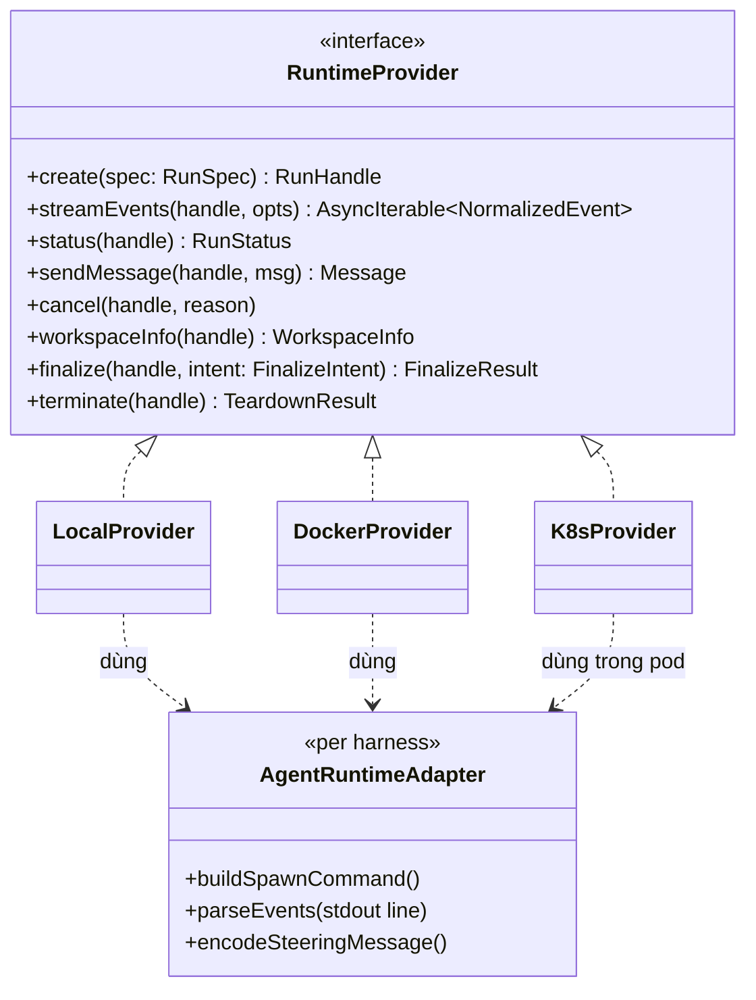

`RuntimeProvider` trả lời câu hỏi *agent chạy ở đâu*. `AgentRuntimeAdapter` trả
lời câu hỏi *chạy harness nào và đọc output ra sao*. Hai trục độc lập, nên thêm
một harness mới không cần sửa provider.

---

## 4. Flow — vòng đời một run

### 4.1 Ai có thể tạo run

Mọi đường đều đổ về một hàm duy nhất: `spawnRun`.

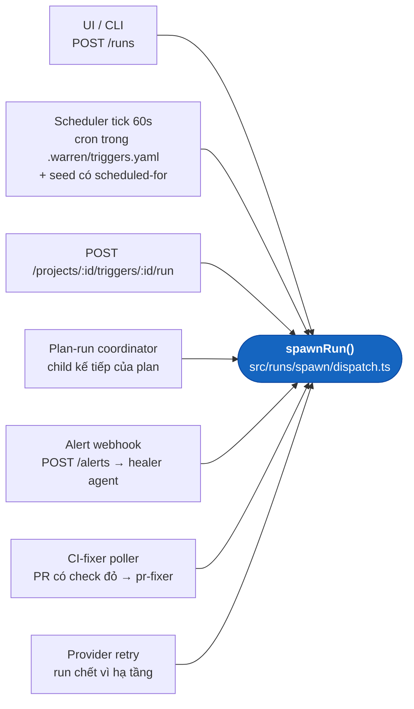

### 4.2 Sequence: dispatch → chạy → reap

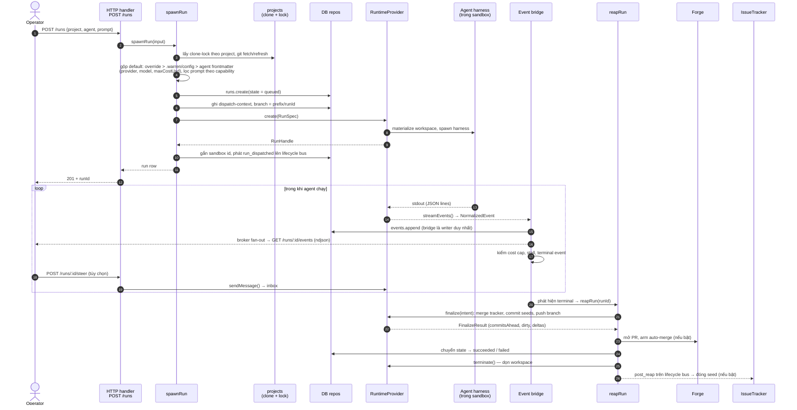

### 4.3 State machine của run

Từ vựng state nằm ở `src/core/wire.ts` (`RUN_STATES`).

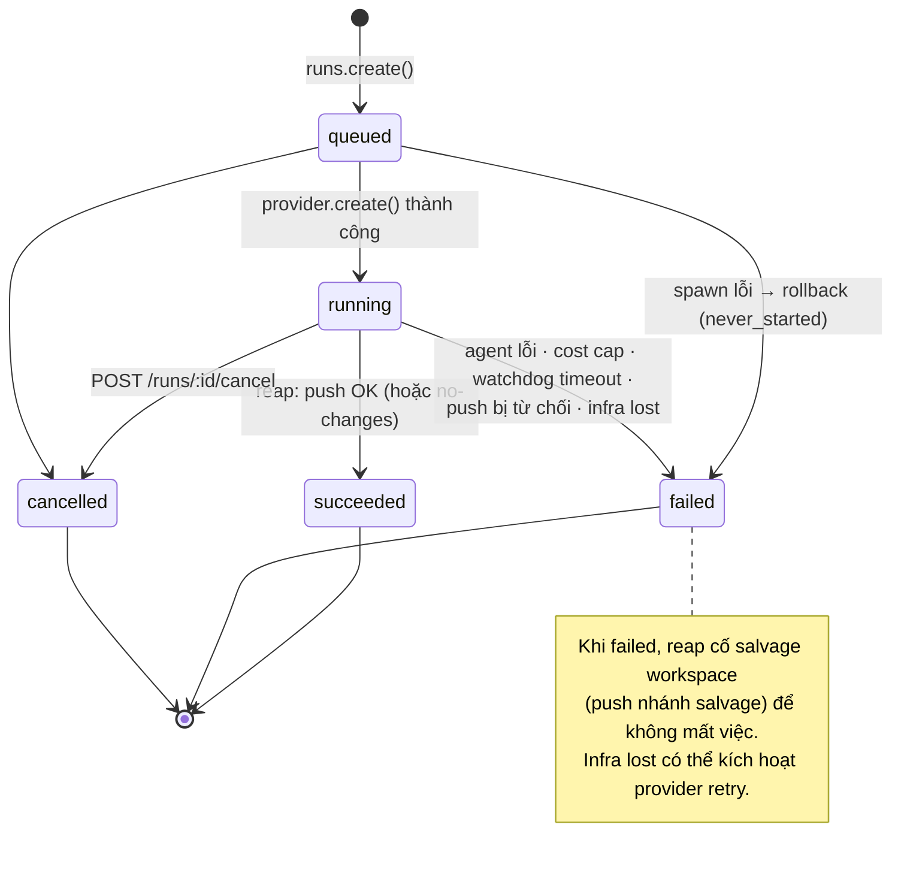

### 4.4 Reap pipeline chi tiết

Reap là bước "thu hoạch" sau khi agent dừng: đưa kết quả lên git, quyết định
state cuối, rồi dọn sandbox. Code nằm ở `src/runs/reap/`:
`run.ts` (`reapRun`, điều phối), `pipeline.ts` (chuỗi bước khi có workspace),
`finalize-intent.ts`, `pr-open.ts`, `salvage.ts`, `destroy.ts`.

**Ai gọi reap.** Event bridge khi phát hiện terminal event, bridge-reconnect,
watchdog (run im lặng quá heartbeat, mặc định 45 phút), cancel
(`POST /runs/:id/cancel`, cancel plan-run), pause/resume. Mọi đường gọi đều
truyền một `outcome` ban đầu (`succeeded` / `failed` / `cancelled`).

```mermaid
flowchart TB
    trig(["reapRun(runId, outcome)<br/>từ bridge · watchdog · cancel"]) --> g0{"run đã<br/>terminal?"}
    g0 -- "rồi" --> idem["reap.skipped<br/>(idempotent)"]
    g0 -- "chưa" --> p1

    subgraph phase1["① Phân loại đầu vào — run.ts"]
        direction TB
        p1["markAgentEnded"] --> p2["quét event log tìm<br/>provider error ở turn cuối<br/>→ ép outcome = failed"]
        p2 --> p3["provider.workspaceInfo()<br/>→ workspacePath, branch"]
        p3 --> p4["baseBranch = run.ref<br/>?? project.defaultBranch"]
        p4 --> p5["bus: pre_reap"]
    end

    p5 --> route{"chọn nhánh"}
    route -- "state vẫn queued" --> s1["reap.never_started_skip"]
    route -- "spawn exec lỗi" --> s2["reap.spawn_failed_skip"]
    route -- "project đã bị xóa" --> s3["reap.orphaned"]
    route -- "bình thường" --> b0

    subgraph phase2["② Pipeline — pipeline.ts"]
        direction TB
        b0["snapshot plans.jsonl<br/>của clone (baseline)"] --> b1

        subgraph fin["provider.finalize(intent) — 1 lần gọi"]
            direction TB
            b1["merge mulch → clone"] --> b2["merge seeds → clone"]
            b2 --> b3["mirror plans → clone"]
            b3 --> b4["chụp plans.jsonl<br/>của workspace"]
            b4 --> b5["commit chore(warren)<br/>seeds state"]
            b5 --> b6["reset file do warren seed<br/>(chặn lọt vào PR)"]
            b6 --> b7["git push branch<br/>(credential mint tại chỗ)"]
            b7 --> b8["đếm commitsAhead,<br/>dirty paths"]
        end

        b8 --> c1{"push OK và<br/>commitsAhead = 0?"}
        c1 -- "có" --> c2["classifyEmptyPush<br/>→ noChanges hoặc droppedCommit"]
        c1 -- "không" --> c3
        c2 --> c3["K8s: áp mirror delta<br/>vào host clone"]
        c3 --> c4["ghi outcome facts<br/>commitsAhead + diff stats"]
        c4 --> c5["auto-plan-run:<br/>plan mới → tạo plan-run"]
        c5 --> c6["mở PR + arm auto-merge"]
        c6 --> c7["preview launch<br/>+ ghi URL vào PR"]
    end

    c7 --> d0
    s1 --> d0
    s2 --> d0
    s3 --> d0

    subgraph phase3["③ Chốt kết quả — run.ts"]
        direction TB
        d0["tính effectiveOutcome<br/>+ failureReason"] --> d1{"finalize<br/>thất bại?"}
        d1 -- "có" --> d2["salvage: push rescue ref<br/>hoặc git bundle"]
        d1 -- "không" --> d3
        d2 --> d3["transitionToTerminal<br/>+ emit reap.completed"]
        d3 --> d4["provider.terminate()<br/>trừ khi cần giữ workspace"]
        d4 --> d5["bus: branch_pushed, post_reap<br/>→ seed-close đóng seed"]
        d5 --> d6["infra lost?<br/>→ retry tự động 1 lần"]
    end

    classDef seam fill:#ef6c00,stroke:#e65100,color:#fff
    classDef dom fill:#1565c0,stroke:#0d47a1,color:#fff
    class b1,b2,b3,b4,b5,b6,b7,b8 seam
    class c1,c2,c3,c4,c5,c6,c7 dom
```

Màu cam là phần chạm vào workspace. Phần này được gom vào **một** lần gọi
`provider.finalize()`: local chạy trên host, K8s chạy trong pod rồi POST kết quả
về. Màu xanh là bước domain, chạy trong Warren cho mọi provider.

#### Phân loại push rỗng (`classifyEmptyPush`)

| Workspace sau push | Kết luận | State |
|---|---|---|
| sạch, 0 commit mới | `noChanges`: agent không sửa gì | `succeeded`, trừ run nhắm `ref` / `targetBranch` thì `failed` / `no_changes` |
| chỉ bẩn file bookkeeping | `noChanges` | như trên |
| bẩn file thật, 0 commit | `droppedCommit`: agent sửa nhưng quên commit | `failed` / `dropped_commit` |

#### Thứ tự ưu tiên `failureReason`

Một run có `outcome = succeeded` vẫn có thể bị lật thành `failed`. Lý do đầu
tiên khớp trong danh sách sẽ thắng:

1. `dropped_commit`
2. `no_changes` (chỉ với run nhắm ref có sẵn)
3. infra loss: Spot preemption, pod biến mất, OOM
4. `provider_error`: ví dụ hết credit API
5. `finalize_unposted` → `push_rejected_policy` → `finalize_failed`
6. lý do do bên gọi truyền vào, hoặc suy ra từ event log

#### Khi nào workspace **không** bị xóa

- Push thất bại **và** salvage cũng thất bại: giữ workspace để operator cứu
  việc bằng tay.
- Preview còn `live` / `starting`: việc xóa chuyển cho eviction worker.

#### Các nguyên tắc thiết kế

- **Best-effort từng bước.** Mỗi bước lỗi sẽ emit `reap_failed {step}` rồi chạy
  tiếp. Pipeline không throw.
- **Fail closed khi không chắc đã giao hàng.** Nếu finalize throw hoặc không đọc
  được workspace thì Warren coi như push thất bại. Run không thể hiện
  `succeeded`, và workspace được salvage hoặc giữ lại.
- **Credential mint ngay trước khi dùng**, không lưu trong config.
- **Auto-merge không bao giờ làm fail run.** Bước arm emit đúng một event và
  im lặng hoàn toàn khi project không bật `pr.autoMerge`.
- **Tính năng phụ treo vào lifecycle bus.** Đóng seed là subscriber của
  `post_reap`, không phải một bước trong pipeline. Bỏ tính năng là bỏ đăng ký.

### 4.5 Run trong K8s — pod gọi ngược về Warren

Trong topology K8s không có engine host-side. Pod tự chạy harness qua
`agent-entrypoint.ts` và dùng HTTP để lấy những gì nó cần.

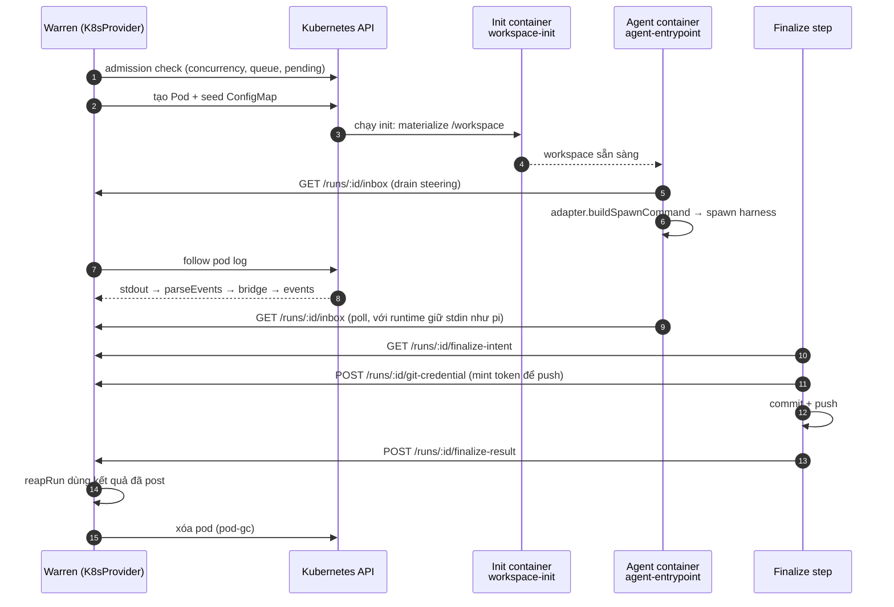

### 4.6 Plan-run: chuỗi issue gate theo PR merge

`POST /plan-runs` với `planId` (tracker hỗ trợ plan, ví dụ seeds) hoặc danh
sách issue id. Coordinator chạy từng child một, child sau chỉ bắt đầu khi PR của
child trước đã merge.

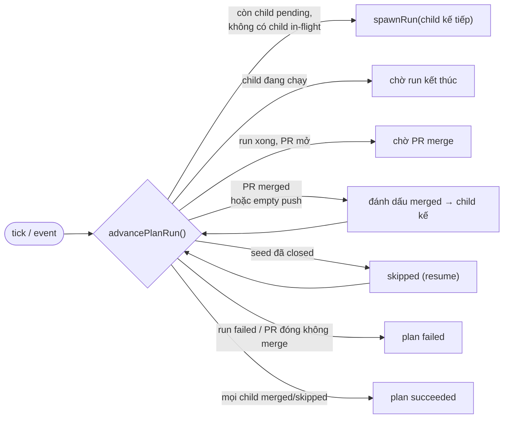

Dispatch lại cùng plan sẽ **resume** từ child mở kế tiếp, vì child có seed đã
đóng sẽ bị skip.

---

## 5. Boot sequence

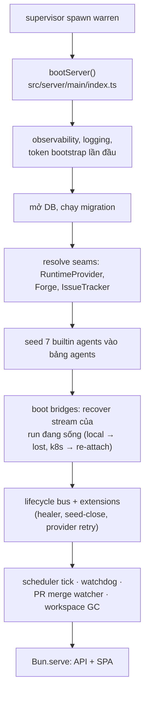

---

## 6. Bản đồ thư mục

| Thư mục | Vai trò |
|---|---|
| `src/supervisor/` | Process cha. Spawn server, chuyển tiếp signal. |
| `src/server/main/` | Composition root. Mọi wiring lúc boot. |
| `src/server/handlers/` | HTTP handler mỏng. `route-table.ts` là danh sách route chính thức. |
| `src/runs/spawn/` | `spawnRun`: một nơi duy nhất tạo run. |
| `src/runs/stream/` | Event bridge. Writer duy nhất của bảng `events`, fan-out cho tailer. |
| `src/runs/reap/` | Kết thúc run: finalize, push, PR, auto-merge, salvage, teardown. |
| `src/plan-runs/` | Coordinator chạy chuỗi issue theo thứ tự, gate bằng PR merge. |
| `src/triggers/` | Scheduler tick: cron, seed hẹn giờ, ci-fixer pass, project heal. |
| `src/healer/`, `src/ci-fixer/` | Vòng tự sửa: alert → healer, CI đỏ → pr-fixer. |
| `src/runtime/` | `RuntimeProvider` contract + local / docker / k8s + adapters harness. |
| `src/sandbox/` | bwrap (Linux), seatbelt (macOS), git scope, proxy. |
| `src/workspace/` | Materialize checkout cho mỗi run. |
| `src/forge/` | `Forge` contract: GitHub, GitHub App, GitLab, ADO. Chỉ nơi này gọi GitHub API. |
| `src/tracker/` | `IssueTracker` contract: seeds + RemoteTracker. |
| `src/projects/` | Đăng ký project, clone, refresh, lock theo project. |
| `src/registry/` | Định nghĩa 7 builtin agent. Path được bảo vệ (Article IX). |
| `src/warren-config/` | Đọc `.warren/config.yaml` theo từng project. |
| `src/db/` | Drizzle schema (sqlite + postgres) và repos. |
| `src/core/` | Wire vocabulary dùng chung server / SDK / UI. Không import gì. |
| `src/client/` | SDK TypeScript cho HTTP API. |
| `src/cli/` | `warren` CLI (commander), dùng SDK. |
| `src/ui/` | SPA React, package riêng `@os-eco/warren-ui`. |
| `src/preview/` | Preview environment cho mỗi run (proxy, port, eviction). |
| `src/observability/` | Log redaction, Prometheus metrics, error tracking. |
| `extensions/` | Package độc lập, chỉ dùng HTTP API công khai. |

## Đọc tiếp

- [RuntimeProvider contract](./runtime-provider-contract.md)
- [Runtime and supervisor](./runtime-and-supervisor.md)
- [Agent composition](./agent-composition.md)
- [PlanRun coordinator](./plan-run-coordinator.md)
- [Forge contract](./forge-contract.md) · [IssueTracker contract](./issue-tracker.md)
- [Kubernetes migration](./k8s-migration.md) · [Docker runtime provider](./runtime-docker-provider.md)
- [Tier-1 observation bus](./tier1-observation-bus.md) · [Scheduler](./scheduler.md)
