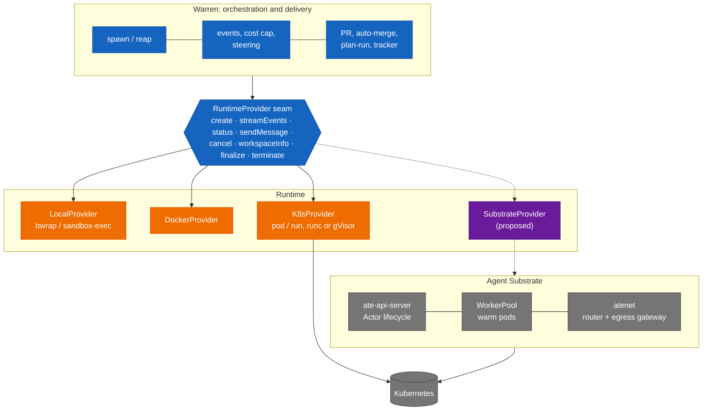
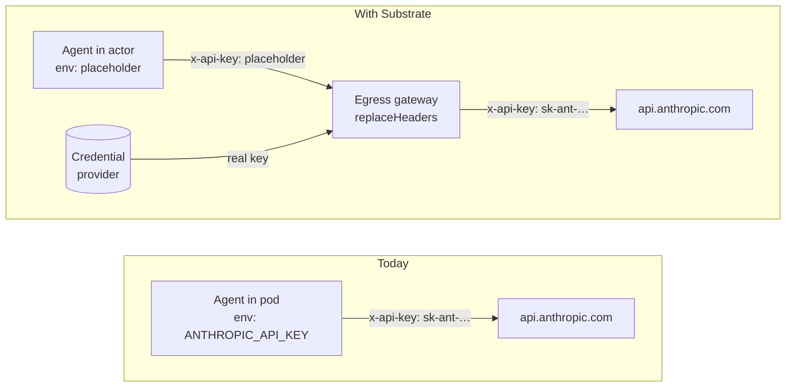

# Agent Substrate integration assessment

**Kind:** proposal
**Design state:** draft
**Delivery:** unscheduled
**Arrived:** 2026-11-20
**Related:** [`runtime-provider-contract.md`](runtime-provider-contract.md),
[`k8s-migration.md`](k8s-migration.md),
[`resumable-agent-environments.md`](resumable-agent-environments.md)

This document answers one question. Does an integration of Warren with
[Agent Substrate](https://github.com/agent-substrate/substrate) (Go, Apache-2.0,
version 1.0) make Warren more effective, or does it only add redundancy?

The Substrate facts come from the README, `docs/concepts/architecture.md`,
`docs/reference/glossary.md`, `docs/guides/egress-credential-injection.md`,
`docs/guides/observability.md`, and the `claude-code-multiplex` demo of that
repo, read on 2026-11-20. Points that no experiment has verified carry the mark
**needs a spike**.

## Short conclusion

1. **It is not redundant in architecture.** The two systems sit at different layers.
   Warren is the orchestration and delivery layer: task → branch / PR, events, cost,
   plan-run, tracker. Substrate is the runtime layer: sandbox, scheduling, snapshots,
   network, identity. Substrate replaces exactly one part: the "one pod per run" part of
   `K8sProvider`. This part sits behind the `RuntimeProvider` seam, so the integration adds
   **a fourth provider**. It does not change the domain.
2. **The largest benefit is security, not density.** Today Warren puts
   `ANTHROPIC_API_KEY` and the run token into the sandbox environment. Substrate can
   keep credentials **outside** the sandbox (the egress gateway replaces the header) and
   block egress per host. The ability to pack 10 to 30 actors into one pod has little value
   at Warren's scale: one team, a few dozen concurrent runs.
3. **Suspend/resume does not fit the current Run.** While a run executes, the agent is
   almost always busy. It streams tokens from the model and keeps a connection open. Suspend
   has value only *between* runs. That is the problem of the
   [Resumable agent environments](resumable-agent-environments.md) proposal, which has no
   schedule yet.
4. **Recommendation: do not integrate now.** First use what Warren already
   has: `resources.runtimeClass: gvisor` and `resources.network: restricted`.
   Build `SubstrateProvider` only when one of the conditions in
   [§6](#6-when-to-build-it) applies.

---

## 1. Where the two systems sit

## 2. Where they overlap and where they complement

| Capability | Warren today | Substrate | Assessment |
|---|---|---|---|
| Task → branch / PR, plan-run, tracker | ✅ | ❌ | Only Warren has it |
| Event stream, cost cap, steering, salvage | ✅ | ❌ | Only Warren has it |
| Sandbox per run | bwrap, container, pod (runc / gVisor) | gVisor or microVM, mandatory | **Overlap.** Substrate is stronger because it has microVM. |
| Queue, concurrency limits | K8s admission gate (429) | WorkerPool + request parking | **Overlap.** Choose one side. |
| Agent logs | Follow the pod log through the K8s API | `kubectl ate logs actor -f`, JSON logs with `ate.*` labels | **Overlap.** Change the log source. |
| Credentials outside the sandbox | ❌ (key is in env) | ✅ egress gateway replaces the header | **Substrate adds this** |
| Egress per host / L7 | NetworkPolicy, levels `none / restricted / open` | `EgressPolicy` per actor, blocked by default | **Substrate adds this** |
| Identity per agent | HMAC run token | SPIFFE X.509, actor JWT | **Substrate adds this** |
| Snapshot / suspend / resume | ❌ (proposal only) | ✅ memory, rootfs, volume | **Substrate adds this** for Environment |
| Golden snapshot (warm start) | Git mirror cache in `workspace-init` | ✅ snapshot per ActorTemplate | **Substrate adds this** in part |
| Density (many actors / pod) | ❌ | ✅ | Little value at Warren's scale |

The overlapping parts (sandbox, queue, logs) do **not** run twice after the integration.
The integration replaces that part of `K8sProvider`. The two do not run in parallel.

## 3. Specific benefits, ranked by value

### 3.1 Credentials never enter the sandbox

Today, per `.env.example` and `src/runs/spawn/callback-env.ts`, the sandbox gets
`ANTHROPIC_API_KEY` (or `CLAUDE_CODE_OAUTH_TOKEN`) and a per-run `WARREN_API_TOKEN`.
On K8s, the pod also requests a git token through
`POST /runs/:id/git-credential` to push. An agent hit by prompt injection (for example
through issue content, a README, or a dependency) can read these values and
send them out.

The same mechanism also works for git push over HTTPS (the `Authorization` header) and for
the OpenRouter API that `pi` calls.

**Needs a spike:**

- Does Claude Code accept a placeholder key and trust the gateway CA
  (MITM)?
- Can subscription sign-in (`CLAUDE_CODE_OAUTH_TOKEN`) pass through
  `replaceHeaders`?

### 3.2 Egress blocked by default, opened per host

Warren's `resources.network: restricted` relies on NetworkPolicy, which filters only
at the IP / port level. Substrate's `EgressPolicy` lets you list the exact hosts
that the agent calls: the model API, the git forge, the package registry, the Warren callback URL.
The gateway is also a place to attach DLP or a prompt-injection scanner, outside
the sandbox.

### 3.3 A base for Resumable Environments

The [Resumable agent environments](resumable-agent-environments.md) proposal separates
the **Environment** (workspace, services, data, long-lived) from the **Run** (one
execution, immutable after it ends). That proposal treats a per-provider checkpoint as "an
optional speed-up", with a rebuild from scratch always available as the fallback. Substrate
supplies exactly this optional part: snapshots at the `VOLUMES`, `ROOTFS`, or `MEMORY` level,
with resume in under 500 ms per the Substrate docs. An Environment can
hibernate while it waits for a person to review the PR, then resume at the next run (CI
fixer, continuation run, steer) with no new clone and no new `bun install`.

### 3.4 Faster startup

A golden snapshot of an ActorTemplate with the toolchain and dependencies already in place
removes the install step from each run. Today Warren has only a git mirror cache. The gain
depends on the repo: large for a monorepo with a slow install, small for a light repo.

### 3.5 Density

Little value for Warren. A Warren run executes continuously from start to end with no idle
intervals, so there is no idle time to multiplex. Density matters only when long-lived
Environments exist and are often idle.

## 4. Where they do not fit

- **Request / response model compared with batch.** Substrate is designed for actors
  that a request through the router wakes up. A Warren run is a process that runs
  until it finishes. The `claude-code-multiplex` demo also works in batch style: it
  controls the actor through `ateapi`, not through the router. So it works, but it does not
  use all of Substrate.
- **No suspend during a run.** A suspend while the agent waits for the model cuts the
  HTTPS connection. As the Resumable Environments proposal states, `RUN_STATES` must not
  get `paused` / `hibernating`.
- **Init container.** `K8sProvider` uses the `workspace-init` init container to
  clone the repo. The ActorTemplate docs mention "container image(s)" but do not make clear
  whether an init order exists. **Needs a spike.** Fallback: clone directly in the
  entrypoint.
- **Callbacks to Warren.** The pod calls back to Warren (`/inbox`, `/finalize-intent`,
  `/finalize-result`, `/salvage`). Egress for an actor is blocked by default, so
  `EgressPolicy` must open the Warren URL.
- **Language.** The Substrate API is gRPC, written in Go. Warren uses Bun /
  TypeScript, so it needs a generated gRPC client for TS.

## 5. `SubstrateProvider` sketch

Mapping of the 8 methods of `RuntimeProvider` (`src/runtime/contract.ts`):

| Method | Implementation on Substrate | Notes |
|---|---|---|
| `create(spec)` | Create an Actor from an ActorTemplate per agent image, with the run's `EgressPolicy`, then resume | Templates are immutable: each new image is a new template |
| `streamEvents` | Follow the actor log (JSON logs, filtered by `ate.actor.*`), then pass it through the existing adapter parser | Alternative: the entrypoint POSTs NDJSON to Warren (option B in k8s-migration §5.1) |
| `status` | Read the Actor state from `ateapi` | Map to `RunStatus` |
| `sendMessage` | Keep the Warren inbox. The entrypoint pulls from it | Substrate does nothing here |
| `cancel` | Send a stop signal, or delete the actor | |
| `workspaceInfo` | `{ workspacePath: null, branch }`, the same as K8s | |
| `finalize` | Keep the current pod protocol: `finalize-intent` / `finalize-result` | Git push can use credential injection instead of minting a token |
| `terminate` | Delete the Actor. Later: suspend instead of delete, if an Environment exists | |

Most of the in-pod code is reusable: `agent-entrypoint.ts`,
`finalize-entrypoint.ts`, the adapters. Most new code is in the control
plane: the gRPC client, the state mapping, the log source. The domain layer
(`src/runs/*`, reap, plan-run) does not change.

## 6. When to build it

Build it when **at least one** of these conditions applies:

1. Warren runs on repos, issues, or prompts from **untrusted** sources: public
   repos, issues from outsiders, campaign mode on an upstream repo. Then
   keeping credentials outside the sandbox is a requirement, not an optimization.
2. Work on Resumable Environments starts and needs fast checkpoints.
3. The organization **already operates** Substrate (for example GKE Substrate), so the
   added operating cost is almost zero.
4. Concurrent runs reach the hundreds and the cost of warm pods becomes a problem.

Do not build it yet when: there is only one team with trusted repos, the `local`
or `docker` runtime is in use, or no Kubernetes cluster exists. Then the operating cost of
Substrate is larger than the benefit: control plane, database, object storage for snapshots,
gVisor / microVM nodes, atenet.

## 7. Proposed roadmap

| Phase | Work | Cost |
|---|---|---|
| 0. Now | Turn on `resources.runtimeClass: gvisor` and `resources.network: restricted` for sensitive projects. Set `maxCostUsd`. | Config change only |
| 1. Spike | One ActorTemplate that runs the Warren agent image, dispatched by hand. Measure startup time, log reads, callbacks to Warren, credential injection for the Anthropic API. | A few days |
| 2. Provider | `SubstrateProvider` behind `WARREN_RUNTIME=substrate`, with credential injection for the model key and git | A few weeks, plus provider conformance tests |
| 3. Environment | Implement Resumable Environments, with Substrate suspend/resume as the optional checkpoint | Per the Resumable Environments proposal |

## 8. Risks

- **Upstream Warren is no longer maintained** (README, 11/2026). You must maintain the new
  provider yourself, or contribute it to the `luantaraschi/warren` fork.
- The Substrate Claude Code demo works around two upstream bugs (`#189`, `#197`)
  related to OCI bundles and symlinks. The Warren agent image can hit similar
  bugs.
- Credential injection requires the agent to trust the gateway CA. Some tools in the sandbox
  (npm, pip, git) can need their own CA configuration.
- `kubectl ate logs` reads logs only from the current worker pod. If a long run moves to
  a different pod, it needs a central log backend, or events can be lost. This is
  a reason to consider an entrypoint that POSTs events to Warren.

## Open questions

- Does ActorTemplate support init container ordering?
- Does Claude Code (API key and OAuth) work with a placeholder plus a MITM CA?
- Which event source to choose: the actor log or a direct push from the entrypoint?
- How does Warren's `admission.maxConcurrentRuns` map to the WorkerPool size
  and request parking?
