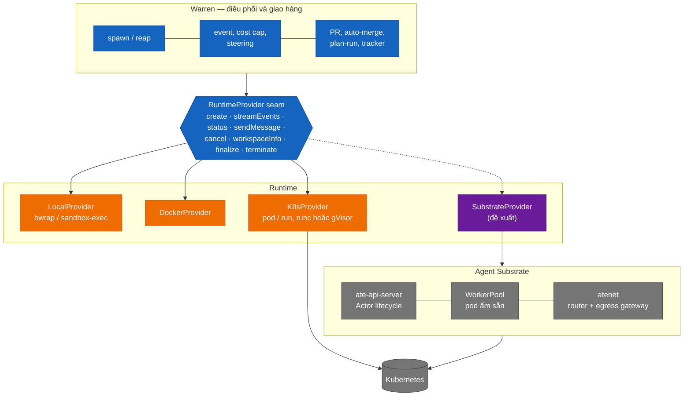
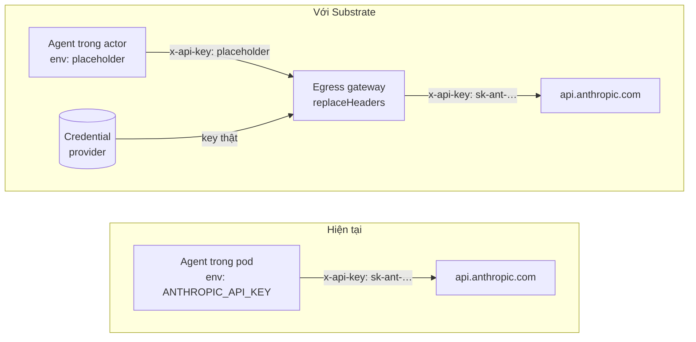

# Agent Substrate integration assessment

**Kind:** proposal
**Design state:** draft
**Delivery:** unscheduled
**Arrived:** 2026-11-20
**Related:** [`runtime-provider-contract.md`](runtime-provider-contract.md),
[`k8s-migration.md`](k8s-migration.md),
[`resumable-agent-environments.md`](resumable-agent-environments.md)

Tài liệu này trả lời một câu hỏi: tích hợp Warren với
[Agent Substrate](https://github.com/agent-substrate/substrate) (Go, Apache-2.0,
bản 1.0) có giúp Warren hiệu quả hơn không, hay chỉ là thừa?

Thông tin về Substrate lấy từ README, `docs/concepts/architecture.md`,
`docs/reference/glossary.md`, `docs/guides/egress-credential-injection.md`,
`docs/guides/observability.md` và demo `claude-code-multiplex` của repo đó, đọc
ngày 2026-11-20. Những điểm chưa kiểm chứng bằng thực nghiệm được ghi rõ là
**cần spike**.

## Kết luận ngắn

1. **Không thừa về kiến trúc.** Hai hệ thống nằm ở hai tầng khác nhau.
   Warren là tầng điều phối và giao hàng: task → branch / PR, event, chi phí,
   plan-run, tracker. Substrate là tầng runtime: sandbox, lịch chạy, snapshot,
   mạng, identity. Substrate thay đúng một chỗ: phần "mỗi run một pod" của
   `K8sProvider`. Chỗ này nằm sau seam `RuntimeProvider`, nên tích hợp là thêm
   **một provider thứ tư**, không phải sửa domain.
2. **Lợi ích lớn nhất là bảo mật, không phải mật độ.** Warren hiện đưa
   `ANTHROPIC_API_KEY` và run token vào môi trường của sandbox. Substrate có thể
   giữ credential **bên ngoài** sandbox (egress gateway tự thay header) và chặn
   egress theo từng host. Khả năng nhồi 10 đến 30 actor vào một pod ít giá trị
   với quy mô của Warren: một team, vài chục run đồng thời.
3. **Suspend/resume không hợp với Run hiện tại.** Trong lúc chạy, agent gần như
   luôn bận: đang stream token từ model, giữ kết nối mở. Suspend chỉ có giá trị
   *giữa* các run. Đó chính là bài toán của đề xuất
   [Resumable agent environments](resumable-agent-environments.md), hiện chưa
   được lên lịch.
4. **Khuyến nghị: chưa tích hợp ngay.** Trước hết hãy dùng những gì Warren đã
   có: `resources.runtimeClass: gvisor` và `resources.network: restricted`.
   Chỉ nên làm `SubstrateProvider` khi gặp một trong các điều kiện ở
   [§6](#6-khi-nào-nên-làm).

---

## 1. Hai hệ thống nằm ở đâu

## 2. Chỗ nào trùng, chỗ nào bổ sung

| Năng lực | Warren hiện có | Substrate có | Đánh giá |
|---|---|---|---|
| Task → branch / PR, plan-run, tracker | ✅ | ❌ | Chỉ Warren có |
| Event stream, cost cap, steering, salvage | ✅ | ❌ | Chỉ Warren có |
| Sandbox mỗi run | bwrap, container, pod (runc / gVisor) | gVisor hoặc microVM, bắt buộc | **Trùng.** Substrate mạnh hơn nhờ có microVM. |
| Hàng đợi, giới hạn đồng thời | Admission gate K8s (429) | WorkerPool + request parking | **Trùng.** Chọn một bên. |
| Log của agent | Follow log pod qua K8s API | `kubectl ate logs actor -f`, log JSON kèm nhãn `ate.*` | **Trùng.** Đổi nguồn log. |
| Credential ngoài sandbox | ❌ (key nằm trong env) | ✅ egress gateway thay header | **Substrate bổ sung** |
| Egress theo host / L7 | NetworkPolicy, mức `none / restricted / open` | `EgressPolicy` theo từng actor, mặc định chặn | **Substrate bổ sung** |
| Identity cho từng agent | HMAC run token | SPIFFE X.509, actor JWT | **Substrate bổ sung** |
| Snapshot / suspend / resume | ❌ (chỉ có đề xuất) | ✅ memory, rootfs, volume | **Substrate bổ sung** cho Environment |
| Golden snapshot (khởi động ấm) | Git mirror cache trong `workspace-init` | ✅ snapshot theo ActorTemplate | **Substrate bổ sung** một phần |
| Mật độ (nhiều actor / pod) | ❌ | ✅ | Ít giá trị ở quy mô Warren |

Phần trùng (sandbox, hàng đợi, log) **không** bị nhân đôi khi tích hợp. Phần đó
của `K8sProvider` sẽ được thay chứ không chạy song song.

## 3. Lợi ích cụ thể, xếp theo giá trị

### 3.1 Credential không bao giờ vào sandbox

Hiện tại, theo `.env.example` và `src/runs/spawn/callback-env.ts`, sandbox nhận
`ANTHROPIC_API_KEY` (hoặc `CLAUDE_CODE_OAUTH_TOKEN`) và một `WARREN_API_TOKEN`
theo từng run. Ở K8s, pod còn xin git token qua
`POST /runs/:id/git-credential` để push. Một agent bị prompt injection (ví dụ
qua nội dung issue, README hoặc dependency) có thể đọc được các giá trị này rồi
gửi ra ngoài.

Cơ chế này cũng dùng được cho git push qua HTTPS (header `Authorization`) và cho
API của OpenRouter mà `pi` gọi.

**Cần spike:**

- Claude Code có chấp nhận một key placeholder và trust CA của gateway (MITM)
  không?
- Đăng nhập kiểu subscription (`CLAUDE_CODE_OAUTH_TOKEN`) có đi qua được
  `replaceHeaders` không?

### 3.2 Egress chặn mặc định, mở theo host

`resources.network: restricted` của Warren dựa vào NetworkPolicy, chỉ lọc được
ở mức IP / port. `EgressPolicy` của Substrate cho phép liệt kê đúng các host
được gọi: model API, git forge, registry package, URL callback của Warren.
Gateway còn là chỗ gắn được DLP hoặc bộ quét prompt injection, nằm ngoài
sandbox.

### 3.3 Nền cho Resumable Environments

Đề xuất [Resumable agent environments](resumable-agent-environments.md) tách
**Environment** (workspace, service, dữ liệu, sống lâu) khỏi **Run** (một lần
chạy, không đổi sau khi xong). Đề xuất đó coi checkpoint theo provider là "tùy
chọn để tăng tốc", luôn có đường dựng lại từ đầu làm dự phòng. Substrate cung
cấp đúng phần tùy chọn này: snapshot ở mức `VOLUMES`, `ROOTFS` hoặc `MEMORY`,
resume dưới 500 ms theo tài liệu của Substrate. Một Environment có thể
hibernate trong lúc chờ người review PR, rồi resume khi có run tiếp theo (CI
fixer, continuation run, steer) mà không phải clone và `bun install` lại.

### 3.4 Khởi động nhanh hơn

Golden snapshot của một ActorTemplate có sẵn toolchain và dependency giúp bỏ
bước cài đặt ở mỗi run. Warren hiện chỉ có git mirror cache. Mức lợi phụ thuộc
vào repo: lớn với monorepo cài lâu, nhỏ với repo nhẹ.

### 3.5 Mật độ

Ít giá trị cho Warren. Run của Warren chạy liên tục từ đầu đến cuối, không rảnh
xen kẽ, nên không có khoảng rảnh để multiplex. Mật độ chỉ có ý nghĩa khi đã có
Environment sống lâu và thường xuyên rảnh.

## 4. Chỗ không khớp

- **Mô hình request / response so với batch.** Substrate được thiết kế cho actor
  được đánh thức bởi request đi qua router. Run của Warren là một process chạy
  đến khi xong. Demo `claude-code-multiplex` cũng làm theo kiểu batch: điều
  khiển actor qua `ateapi`, không đi qua router. Vậy là dùng được, nhưng không
  tận dụng hết Substrate.
- **Không suspend giữa run.** Suspend khi agent đang chờ model sẽ cắt đứt kết
  nối HTTPS. Như đề xuất Resumable Environments đã nêu, `RUN_STATES` không nên
  có thêm `paused` / `hibernating`.
- **Init container.** `K8sProvider` dùng init container `workspace-init` để
  clone repo. Tài liệu ActorTemplate nói tới "container image(s)" nhưng chưa rõ
  có thứ tự init hay không. **Cần spike.** Phương án dự phòng: clone ngay trong
  entrypoint.
- **Callback về Warren.** Pod gọi ngược về Warren (`/inbox`, `/finalize-intent`,
  `/finalize-result`, `/salvage`). Actor mặc định bị chặn egress, nên
  `EgressPolicy` phải mở URL của Warren.
- **Ngôn ngữ.** API của Substrate là gRPC, viết bằng Go. Warren dùng Bun /
  TypeScript, nên cần sinh client gRPC cho TS.

## 5. Phác thảo `SubstrateProvider`

Ánh xạ 8 method của `RuntimeProvider` (`src/runtime/contract.ts`):

| Method | Hiện thực trên Substrate | Ghi chú |
|---|---|---|
| `create(spec)` | Tạo Actor từ ActorTemplate theo agent image, kèm `EgressPolicy` của run, rồi resume | Template là immutable: mỗi image mới là một template mới |
| `streamEvents` | Follow log của actor (log JSON, lọc theo `ate.actor.*`) rồi đưa qua adapter parser có sẵn | Phương án khác: entrypoint POST NDJSON về Warren (phương án B trong k8s-migration §5.1) |
| `status` | Đọc trạng thái Actor từ `ateapi` | Ánh xạ sang `RunStatus` |
| `sendMessage` | Giữ nguyên inbox của Warren, entrypoint tự kéo về | Không cần Substrate làm gì |
| `cancel` | Gửi tín hiệu dừng, hoặc xóa actor | |
| `workspaceInfo` | `{ workspacePath: null, branch }` giống K8s | |
| `finalize` | Giữ nguyên giao thức pod hiện tại: `finalize-intent` / `finalize-result` | Git push có thể dùng credential injection thay cho việc mint token |
| `terminate` | Xóa Actor. Sau này: suspend thay vì xóa, nếu có Environment | |

Phần lớn code trong pod có thể dùng lại: `agent-entrypoint.ts`,
`finalize-entrypoint.ts`, các adapter. Phần viết mới chủ yếu nằm ở control
plane: client gRPC, ánh xạ trạng thái, nguồn log. Lớp domain
(`src/runs/*`, reap, plan-run) giữ nguyên.

## 6. Khi nào nên làm

Nên làm khi gặp **ít nhất một** điều kiện sau:

1. Warren chạy trên repo, issue hoặc prompt từ nguồn **không tin cậy**: repo
   công khai, issue từ người ngoài, chế độ campaign trên repo upstream. Khi đó
   giữ credential ngoài sandbox là yêu cầu, không phải tối ưu.
2. Bắt đầu làm Resumable Environments và cần checkpoint nhanh.
3. Tổ chức **đã vận hành** Substrate (ví dụ GKE Substrate) nên chi phí vận hành
   thêm gần như bằng 0.
4. Số run đồng thời lên tới hàng trăm và chi phí pod ấm thành vấn đề.

Chưa nên làm khi: chỉ có một team và repo tin cậy, đang dùng runtime `local`
hoặc `docker`, hoặc chưa có cụm Kubernetes. Lúc đó chi phí vận hành Substrate
lớn hơn lợi ích: control plane, cơ sở dữ liệu, object storage cho snapshot, node
gVisor / microVM, atenet.

## 7. Lộ trình đề xuất

| Giai đoạn | Việc | Chi phí |
|---|---|---|
| 0. Ngay bây giờ | Bật `resources.runtimeClass: gvisor` và `resources.network: restricted` cho project nhạy cảm. Đặt `maxCostUsd`. | Chỉ sửa config |
| 1. Spike | Một ActorTemplate chạy image agent của Warren, dispatch bằng tay. Đo thời gian khởi động, đọc log, callback về Warren, credential injection cho Anthropic API. | Vài ngày |
| 2. Provider | `SubstrateProvider` sau `WARREN_RUNTIME=substrate`, có credential injection cho model key và git | Vài tuần, cộng test conformance của provider |
| 3. Environment | Hiện thực Resumable Environments, dùng suspend/resume của Substrate làm checkpoint tùy chọn | Theo đề xuất Resumable Environments |

## 8. Rủi ro

- **Warren upstream đã ngừng bảo trì** (README, 11/2026). Provider mới sẽ do bạn
  tự giữ, hoặc phải đưa lên fork `luantaraschi/warren`.
- Demo Claude Code của Substrate đang phải lách hai lỗi upstream (`#189`, `#197`)
  liên quan tới OCI bundle và symlink. Image agent của Warren có thể gặp lỗi
  tương tự.
- Credential injection cần agent tin CA của gateway. Một số tool trong sandbox
  (npm, pip, git) có thể cần cấu hình CA riêng.
- `kubectl ate logs` chỉ đọc log từ worker pod hiện tại. Run dài bị dời sang pod
  khác thì cần một backend log tập trung, nếu không có thể mất event. Đây là lý
  do nên cân nhắc cho entrypoint POST event về Warren.

## Câu hỏi còn mở

- ActorTemplate có hỗ trợ thứ tự init container không?
- Claude Code (API key và OAuth) có chạy được với placeholder cộng MITM CA không?
- Nên chọn nguồn event nào: log của actor hay entrypoint push trực tiếp?
- `admission.maxConcurrentRuns` của Warren sẽ ánh xạ thế nào sang kích thước
  WorkerPool và request parking?
